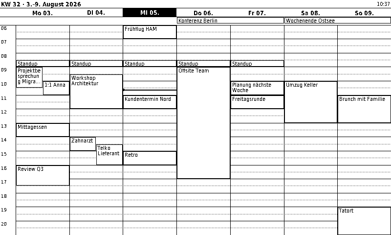

# trmnl-screen-1

A small BYOS ("bring your own server") backend for a **TRMNL OG** e-ink display.
It aggregates several calendars over CalDAV and renders them as a
Monday-to-Sunday week grid: 800×480, 1 bit, no browser involved.



## How it works

The display polls one endpoint on a timer and draws whatever image it is
pointed at:

```
device wakes  ──▶  GET /api/display  ──▶  { image_url, filename, refresh_rate }
                                            │
                   GET /image/<token>/<hash>.bmp  ──▶  800×480 1-bit BMP
                                            │
                   sleeps for refresh_rate seconds
```

Meanwhile the server refreshes calendar data on its own schedule:

```
every 9 min  ──▶  CalDAV fetch  ──▶  expand recurrences  ──▶  layout  ──▶  render
```

`filename` is the device's cache key, so it is set to a hash of the image
content. When nothing in the week changed, the device recognises the unchanged
name, skips the download and does not redraw the panel at all — which saves both
battery and e-ink wear.

## Design notes

**No headless browser.** Terminus and `byos_node_lite` render HTML through
Chrome. A week grid is pure geometry, so Pillow draws it directly: a much
smaller image, ~50 ms per render, and crisper type — anti-aliased browser text
has to be thresholded down to 1 bit, which is exactly what makes small type look
muddy on e-ink. Here it is drawn unantialiased from the start.

**The grid is tight, on purpose.** Seven columns across 800 px leaves 109 px per
day, roughly 17 characters. Two parallel events halve that. Long titles are
wrapped, and words too long for a column are broken rather than ellipsised
mid-title — an ellipsis in the middle would suggest the title ends there while
the next line carries on.

**Adaptive time window.** Rather than a fixed 07:00–21:00, the grid zooms to the
hours actually used that week, with a minimum span of 8 h so a quiet week is not
stretched absurdly and a maximum of 15 h so one 04:00 flight cannot ruin the
resolution of every other day. Events outside the window are shown as `↑n` / `↓n`
edge markers instead of widening it.

**Never a blank screen.** If a calendar cannot be fetched, its last known good
copy is used and its name is marked in the header. A calendar server hiccup
showing an empty week would be the worst possible failure.

## Calendar sources

Two kinds, and they can be combined:

- **CalDAV** (`CALDAV_URL`, `CALDAV_USERNAME`, `CALDAV_PASSWORD`) — Nextcloud or
  any CalDAV server, using an app password.
- **Direct ICS/webcal URLs** (`ICS_URLS`) — fetched on our own schedule.

The second exists to route around a slow intermediary. A Google calendar
subscribed inside Nextcloud is only as fresh as Nextcloud's subscription job,
which defaults to once a day and needs shell access to change. Pointing at
Google's secret iCal address directly puts it back on the 9-minute cycle.
`webcal://` URLs are rewritten to `https://` automatically.

A response that is not iCalendar — a login or error page, say — is treated as a
failure rather than as an empty calendar, so a broken URL cannot silently erase
those events from the screen.

## Configuration

All settings come from environment variables; see [`.env.example`](.env.example).
At least one of the CalDAV trio or `ICS_URLS` must be set.

| Variable | Default | Meaning |
|---|---|---|
| `CALDAV_CALENDARS` | *(all)* | Comma-separated display names, up to 5 |
| `ICS_URLS` | *(none)* | `Name=URL`, comma separated |
| `DATA_DIR` | `/data` | Must be persistent (see below) |
| `URL_PREFIX` | *(none)* | Mount the API under a secret path |
| `ALLOWED_MACS` | *(any)* | MAC allowlist for pairing |
| `LOCK_AFTER_FIRST_PAIRING` | `true` | Refuse a second device |
| `PAIRING_SECRET` | *(none)* | Header/query secret; the firmware cannot send one |
| `DISPLAY_REFRESH_SECONDS` | `900` | Device sleep between polls |
| `FETCH_INTERVAL_MINUTES` | `9` | Calendar refresh |
| `QUIET_START_HOUR` / `QUIET_END_HOUR` | `23` / `5` | Overnight sleep |
| `WEEK_SWITCH_WEEKDAY` / `WEEK_SWITCH_HOUR` | `6` / `12` | Sunday noon flips to next week |
| `GRID_MIN_HOURS` / `GRID_MAX_HOURS` | `8` / `15` | Adaptive window bounds |

## Nextcloud setup

Google calendars are subscribed inside Nextcloud, so this server only ever
speaks CalDAV. Two Nextcloud settings decide whether that actually works:

```bash
# Subscribed calendars refresh very rarely by default.
php occ config:app:set dav calendarSubscriptionRefreshRate --value "PT15M"
```

**Background jobs must be set to system cron**, not AJAX
(*Administration → Basic settings*). With AJAX the refresh job only runs while
somebody has the web UI open, so subscribed calendars effectively never update.

Be aware of the resulting chain for Google events: Google's ICS export cache →
Nextcloud's refresh job → this server's 9-minute fetch → the device's 15-minute
poll. Calendars living natively in Nextcloud are on the display within about
25 minutes; Google events are slower, and by how much is up to Google's cache.

## Running locally

```bash
uv venv --python 3.12 && uv pip install -r requirements.txt -r <(echo pytest httpx ruff)
cp .env.example .env          # then edit it
DATA_DIR=./data .venv/bin/uvicorn app.main:create_app --factory --reload
```

Render a sample week without a server or a device:

```bash
.venv/bin/python scripts/preview_sample.py preview.png
```

Tests:

```bash
.venv/bin/python -m pytest
```

## Deploying to Railway

1. Push this repository and create a Railway service from it. The
   `Dockerfile` and `railway.toml` are picked up automatically.
2. **Attach a volume** and set `DATA_DIR` to its mount path (e.g. `/data`).
   Railway's filesystem is ephemeral — without a volume the device's `api_key`
   is lost on every deploy and the display silently unpairs.
   If the container ever runs as a non-root user, also set `RAILWAY_RUN_UID=0`,
   since volumes are mounted as root.
3. **Turn Serverless off** for this service. Railway considers a service idle
   after ten minutes without *outbound* traffic, and the first request to a
   slept service can return 502 — which the display would see as a failed poll.
   The 9-minute fetch interval keeps a margin below that threshold, but the
   setting is the actual fix.
4. Set the environment variables from `.env.example`, including calendar
   sources and a `URL_PREFIX`.
5. Generate a public domain. That URL plus `URL_PREFIX` is what the display
   gets in pairing mode.

## Pairing the display

In the captive portal: *Advanced → Custom Server → Yes*, then the base URL with
no trailing slash. The firmware appends `/api/...` itself. It calls `/api/setup`
once, stores the returned `api_key`, and uses it for every later `/api/display`.

**The device accepts a URL and nothing else** — no custom headers, no extra
fields. That shapes what pairing protection can look like, because `/api/setup`
is otherwise open to anyone who finds the host:

1. **`URL_PREFIX`** — mount everything under a secret path and hand the device
   `https://your-app.up.railway.app/s/<long-random-string>`. The URL becomes the
   credential. This is the only mechanism that keeps the endpoints from being
   discoverable at all.
2. **`ALLOWED_MACS`** — only listed MAC addresses may register. The MAC is not a
   secret, but combined with 1 it is a solid second gate.
3. **`LOCK_AFTER_FIRST_PAIRING`** (on by default) — after your device has
   paired, no other can. Zero configuration, and enough on its own for a single
   display, though it does mean a stranger who reaches `/api/setup` before you
   do would take the slot. Pair first, then relax.

An already-paired device may always re-run `/api/setup`, so a factory reset does
not lock you out.

`PAIRING_SECRET` is kept for clients that *can* send an `X-Pairing-Secret`
header or `?secret=` parameter. The TRMNL firmware cannot, so do not rely on it
for the display.

## Endpoints

| Endpoint | Purpose |
|---|---|
| `GET/POST /api/setup` | Pairing; returns `api_key` and `friendly_id` |
| `GET/POST /api/display` | Per-wake poll; returns image URL and sleep time |
| `POST /api/log` | Firmware diagnostics, written to the service log |
| `GET /image/<token>/<hash>.bmp` | The rendered screen |
| `GET /preview/<token>.png` | The same screen as PNG, for a browser |
| `POST /preview/<token>/refresh` | Force a calendar refresh |
| `GET /healthz` | Liveness only, outside `URL_PREFIX` for the platform |
| `GET /status` | Render state, stale calendars, device telemetry |

`/image`, `/preview` and `/status` carry the contents of your calendar, so they are
guarded by an unguessable token generated on first start. Retrieve it from the
`kv` table in `state.db`, or read it from the `image_url` that `/api/setup`
returns.

## Licence

The vendored DejaVu Sans Condensed fonts in `fonts/` are covered by
[their own licence](fonts/LICENSE.dejavu).
